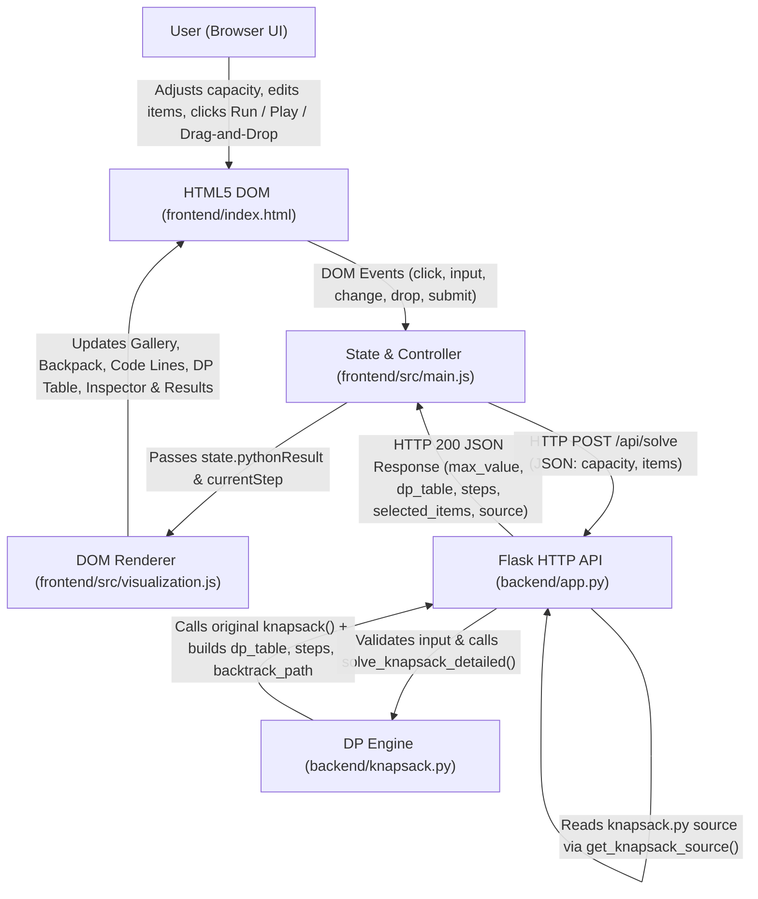

# Complete Project Analysis & Technical Documentation: **Knapsack Visualizer (0/1 Knapsack using Dynamic Programming)**

---

## 1. Complete Project Structure

### 1.1 Complete Directory and File Tree

Below is the exact directory and file structure currently on disk in the workspace:

```text
Project dm/
├── README.md                                  (3,805 bytes)  — Project setup and overview documentation
├── PROJECT_COMPLETE_DOCUMENTATION.md          (This file)    — Complete technical analysis and viva guide
├── backend/
│   ├── __pycache__/                           (Generated)    — Compiled Python bytecode cache (.pyc)
│   ├── app.py                                 (3,135 bytes)  — Flask HTTP server & REST API endpoints
│   ├── knapsack.py                            (9,695 bytes)  — Original 0/1 Knapsack DP algorithm & step tracer
│   └── requirements.txt                       (32 bytes)     — Python package dependencies
└── frontend/
    ├── index.html                             (18,642 bytes) — Frontend HTML entry point & UI layout
    ├── package.json                           (252 bytes)    — Node/Vite scripts and dependency manifest
    ├── package-lock.json                      (34,823 bytes) — Locked npm dependency tree
    ├── node_modules/                          (Generated)    — Installed npm packages (Vite & dependencies)
    ├── dist/                                  (Generated)    — Production build output from `npm run build`
    │   ├── index.html
    │   └── assets/
    │       ├── index-B-X9PRaC.js              (Leftover from earlier build)
    │       ├── index-BnyOac3_.css             (Leftover from earlier build)
    │       ├── index-B5gmBb8L.js              (Latest production JS bundle)
    │       └── index-CWN0HJ6W.css             (Latest production CSS bundle)
    └── src/
        ├── main.js                            (20,278 bytes) — Frontend controller, state, events & API calls
        ├── style.css                          (30,891 bytes) — Complete stylesheet (light academic theme)
        ├── visualization.js                   (22,599 bytes) — DOM rendering, syntax highlighter & DP table builder
        └── assets/
            └── backpack.svg                   (1,679 bytes)  — Standalone SVG illustration (currently unused)
```

---

### 1.2 Purpose of Every Folder and File

#### Root Directory (`Project dm/`)
* **`README.md`** *(Optional documentation)*: Markdown guide explaining the folder layout, how to run the backend and frontend in two separate terminals, and a summary of features.

#### Backend Folder (`backend/`)
This folder contains the **Python server and algorithmic engine**. All Dynamic Programming calculations happen exclusively inside this folder.
* **`backend/knapsack.py`** *(Essential backend module)*: Contains two functions:
  1. `knapsack(weights, values, capacity)` (lines 1–17): The pure, textbook 2D bottom-up Dynamic Programming function that computes and returns the maximum value `dp[n][capacity]`.
  2. `solve_knapsack_detailed(items, capacity)` (lines 20–242): Calls the original `knapsack()` function, builds the step-by-step execution trace (`steps`) with snapshots of the DP matrix (`dp_snapshot`), records active Python line numbers (`active_lines`), performs bottom-up backtracking (`backtrack_path`) to identify which items were chosen (`selected_items`), and computes `total_weight` and `remaining_capacity`.
* **`backend/app.py`** *(Essential — **Backend Entry Point**)*: Initializes the Flask application, enables Cross-Origin Resource Sharing (`CORS(app)`), reads `knapsack.py` from disk so the frontend can display the real Python source code, validates incoming JSON requests, and exposes `/api/health`, `/api/source`, and `/api/solve` on `http://127.0.0.1:5000`.
* **`backend/requirements.txt`** *(Essential configuration)*: Lists the required Python libraries (`flask==3.1.0` and `flask-cors==5.0.0`).

#### Frontend Folder (`frontend/`)
This folder contains the **user interface and interactive visualization engine** served by Vite.
* **`frontend/index.html`** *(Essential — **Frontend Entry Point**)*: Defines the entire HTML structure of the single-page application (Header, Item Gallery, Backpack Container, Simulation Controls & Step Inspector, Python Source Code Panel, Dynamic Programming Table, Optimal Solution Summary, and the native `<dialog id="item-modal">` form). Loads `/src/style.css` (line 10) and `/src/main.js` (line 424).
* **`frontend/package.json`** *(Essential configuration)*: Configures the project as an ES module (`"type": "module"`), declares `vite` (`^6.0.0`) as a development dependency, and defines `npm run dev`, `npm run build`, and `npm run preview`.
* **`frontend/src/main.js`** *(Essential script — **JavaScript Entry Module**)*: Holds the application state (`state`), sends `POST` requests to `http://127.0.0.1:5000/api/solve`, manages simulation timers (`setInterval`), handles drag-and-drop and click packing/unpacking, enforces backpack capacity limits, and coordinates DOM updates by calling functions imported from `visualization.js`.
* **`frontend/src/visualization.js`** *(Essential script)*: Pure DOM-rendering module. Contains the custom regex tokenizer for Python syntax highlighting (`highlightPythonLine`), renders the Python code viewer, builds the item cards, updates the backpack UI and progress bar, constructs the interactive HTML `<table>` for the DP matrix, updates the 4 step-inspector cards, and renders the final results panel.
* **`frontend/src/style.css`** *(Essential stylesheet)*: Defines CSS custom properties (variables), grid layouts, responsive media queries, light-mode code syntax colors, DP table cell states, and modal dialog styling.

---

### 1.3 Unused Files, Duplicated Code, and Leftovers Found in the Codebase

As an honest code audit, here are the exact inconsistencies, unused files, and redundancies present in the project right now:

1. **Unused SVG Asset (`frontend/src/assets/backpack.svg`)**:
   * This file contains a 30-line dark-blue/purple SVG backpack illustration (`#312e81`, `#4f46e5`). It is **not imported or referenced anywhere** in `index.html`, `main.js`, `visualization.js`, or `style.css`. Instead, the backpack container in the UI is built directly in `index.html` (lines 116–146) using HTML `<div>` elements styled in `style.css`.
2. **Unused Backend Endpoints (`GET /api/health` and `GET /api/source`)**:
   * In `backend/app.py` (lines 34–42), two `GET` routes (`/api/health` and `/api/source`) are implemented. However, `frontend/src/main.js` only ever calls `POST /api/solve` (line 85), because `/api/solve` already embeds the Python source code (`result["source"] = get_knapsack_source()`) and updates the connection status pill upon completion.
3. **Algorithmic Duplication Inside `solve_knapsack_detailed`**:
   * In `backend/knapsack.py` (line 31), `solve_knapsack_detailed()` calls `max_value = knapsack(weights, values, capacity)` first (to satisfy the rule that the original function must remain untouched and called), and then runs an identical nested loop (lines 61–172) that recomputes the `dp` table while recording step metadata.
4. **Outdated Line in `README.md`**:
   * `README.md` (line 21) describes `style.css` as `"Deep navy/purple glassmorphic UI"`, which was the initial theme before `style.css` was redesigned to the current light academic theme.
5. **Build Artifacts in `frontend/dist/`**:
   * Contains two generations of hashed CSS/JS files from running `npm run build` twice. This folder is ignored during `npm run dev`.

> **شرح بالمصري (Egyptian Arabic):**
> المشروع متقسم لجزئين أساسيين ومفصولين تماماً:
> 1. فولدر `backend` وده فيه كود البايثون (`knapsack.py` اللي فيه الخوارزمية الأصلية وخطوات الحل، و `app.py` اللي بيشغل سيرفر Flask على بورت `5000`).
> 2. فولدر `frontend` وده الواجهة اللي بتفتح في المتصفح عن طريق Vite (`index.html` للهيكل، `style.css` للتصميم الفاتح البسيط، `main.js` لإدارة الحالة والاتصال بالسيرفر، و `visualization.js` لرسم الجدول والكود والشنطة).
> ومن الملاحظات المهمة لو الدكتور سألك: ملف `backpack.svg` موجود كملف إضافي لكن مش مستخدم في الكود لأن الشنطة مرسومة بـ HTML و CSS مباشرة، وكمان الـ `solve_knapsack_detailed` بتنادي دالة `knapsack` الأصلية الأول عشان تضمن إن النتيجة النهائية جاية من الدالة الأصلية بدون أي تعديل، وبعدين بتعيد بناء الجدول خطوة بخطوة عشان تسجل تاريخ العمليات (`steps`) للواجهة.

---

## 2. Project Overview

### 2.1 What is the Project and What Problem Does It Solve?
**Knapsack Visualizer** is an interactive educational web simulator that demonstrates how the **0/1 Knapsack Problem** is solved using **Bottom-Up Dynamic Programming (Tabulation)**.

Many students struggle to understand how a 2D Dynamic Programming matrix `dp[i][w]` is populated row by row, how the algorithm decides between **including** or **excluding** an item at each sub-capacity `w`, and how the optimal subset of items is recovered from the completed table. A normal calculator only gives the final number (e.g., `$40`). This visualizer solves that educational gap by exposing **every intermediate cell calculation**, **highlighting the exact Python source lines being executed**, and allowing the user to **manually pack items into a virtual backpack** to compare their intuition against the mathematical optimum.

### 2.2 What is the 0/1 Knapsack Problem?
Given:
* A set of $n$ items, where each item $i$ has a positive integer **weight** (`weights[i-1]`) and **value** (`values[i-1]`).
* A backpack with a maximum weight **capacity** $W$.

The goal is to select a subset of items such that:
1. The total weight of the selected items does not exceed $W$.
2. The total value of the selected items is **maximized**.
3. **The 0/1 Constraint**: Each item can either be taken completely (`1`) or left behind (`0`). You cannot take a fraction of an item (unlike the Fractional Knapsack Problem), and you cannot take multiple copies of the same item (unlike the Unbounded Knapsack Problem).

### 2.3 Why Did We Choose Dynamic Programming?
* **Why not Greedy?** A greedy strategy (such as picking items with the highest value-to-weight ratio first) fails for the 0/1 Knapsack Problem because leaving empty capacity that cannot fit the next item can result in a suboptimal total value.
* **Why not Brute Force?** Trying every possible subset of $n$ items requires checking $2^n$ combinations ($O(2^n)$ exponential time). For $n = 30$, $2^{30} \approx 1.07 \times 10^9$ operations.
* **Why Dynamic Programming?** The problem exhibits **overlapping subproblems** and **optimal substructure**. By storing solutions to smaller subproblems (fewer items $i$ and smaller capacities $w$) in a table `dp[i][w]` of size $(n+1) \times (W+1)$, we solve the problem in **pseudo-polynomial time** $O(n \times W)$ without redundant recalculation.

### 2.4 Complete Workflow (From User Action to Visual Output)
1. **Page Load / User Input**: When the page loads (or when the user adjusts the capacity slider/input, adds/edits/deletes an item, or clicks **Run Algorithm**), JavaScript collects the current `capacity` and `items` array.
2. **HTTP Request to Python**: JavaScript sends an HTTP `POST` request with a JSON body to `http://127.0.0.1:5000/api/solve`.
3. **Python Execution**: Flask validates the inputs and calls `solve_knapsack_detailed(items, capacity)` in `backend/knapsack.py`. Python runs `knapsack()`, builds the $(n+1) \times (W+1)$ DP table, records every step (`init`, `compute`, `complete`), backtracks from `dp[n][W]` to find the selected items, reads the source code of `knapsack.py`, and returns everything as a single JSON response.
4. **Interactive Visualization**: JavaScript receives the JSON response and renders:
   * The **Available Items** gallery (marking optimal items with a `★ Optimal` badge).
   * The **Backpack Container** (allowing manual drag-and-drop or automatic packing of the optimal subset).
   * The **Python Source Code** panel (highlighting lines `2, 4`, then `6, 7, 9, 10–13` or `6, 7, 9, 14–15`, and finally `17`).
   * The **Dynamic Programming Table** (highlighting the active cell `dp[i][w]`, the green Include lookup cell `dp[i-1][w - wt]`, and the amber Exclude lookup cell `dp[i-1][w]`).
   * The **Step-by-Step Inspector** and **Optimal Solution Summary**.

> **شرح بالمصري (Egyptian Arabic):**
> فكرة المشروع ببساطة إننا بنحل مشكلة "شنطة السفر" (0/1 Knapsack Problem): عندنا شنطة بتشيل وزن أقصى $W$ (مثلاً 10 كيلو)، وعندنا مجموعة عناصر كل عنصر ليه وزن وليه قيمة بالدولار. كلمة **0/1** معناها إن العنصر يا تاخده كله (`1`) يا تسيبه كله (`0`) — مينفعش تاخد نص كاميرا أو نص لابتوب.
> إيه اللي يخلي المشروع ده **Visualizer** مش مجرد آلة حاسبة؟ الآلة الحاسبة هتقولك "أقصى قيمة هي $40" وخلاص. لكن هنا البايثون بيرجع كل خطوة حصلت جوه الجدول: في كل خلية `dp[i][w]` بيقولك لو خدنا العنصر القيمة هتبقى كام (Include)، ولو سبناه القيمة هتبقى كام (Exclude)، ومين فيهم كسب، وأنهي سطور في كود البايثون اتنفذت في اللحظة دي بالظبط.

---

## 3. Technologies and Tools

Here is the exact classification and role of every technology found in the project files:

| Technology | Category | Where It Appears | Responsibility & How It Integrates |
| :--- | :--- | :--- | :--- |
| **Python 3** | Programming Language & Runtime | `backend/knapsack.py`, `backend/app.py` | Executes the 0/1 Knapsack Dynamic Programming algorithm, builds step histories, performs backtracking, and runs the backend server. |
| **Flask (`3.1.0`)** | Backend Web Framework (Python Library) | `backend/app.py`, `backend/requirements.txt` | Listens for HTTP requests on `127.0.0.1:5000`, parses incoming JSON (`request.get_json`), routes requests to Python functions (`@app.route`), and serializes Python dictionaries into HTTP JSON responses (`jsonify`). |
| **Flask-CORS (`5.0.0`)** | Flask Extension Library | `backend/app.py` (lines 3, 7), `backend/requirements.txt` | Adds Cross-Origin Resource Sharing (`Access-Control-Allow-Origin`) headers to Flask responses so the browser allows the frontend (running on port `5173`) to call the backend (running on port `5000`). |
| **HTML5** | Markup Language | `frontend/index.html` | Structures the user interface, semantic sections (`<header>`, `<main>`, `<section>`, `<table>`), form inputs, and native modal dialog (`<dialog>`). |
| **CSS3** | Stylesheet Language | `frontend/src/style.css` | Controls layout (CSS Grid & Flexbox), colors (CSS variables), typography, table sticky headers, and responsive design (`@media` queries). |
| **Vanilla JavaScript (ES6+ Modules)** | Programming Language (Browser Runtime) | `frontend/src/main.js`, `frontend/src/visualization.js` | Manages client-side state, listens to user events (clicks, sliders, drag-and-drop, modal submission), communicates with Flask via `fetch()`, and updates the DOM. |
| **Vite (`^6.0.0`)** | Frontend Build Tool & Dev Server | `frontend/package.json` | Serves the frontend locally (`npm run dev`) with native ES module support and bundles assets for production (`npm run build`). |
| **HTTP & REST API** | Communication Protocol & Architectural Style | `main.js` (`fetch`) ↔ `app.py` (`@app.route`) | Transfers requests and responses between the browser client and the Python server over TCP port `5000`. |
| **JSON (JavaScript Object Notation)** | Data Interchange Format | `main.js` (`JSON.stringify`) ↔ `app.py` (`jsonify`) | Converts JavaScript objects and Python dictionaries into text strings that can travel across HTTP. |

### Why Flask is Used — and What Would Happen If We Removed It
Browsers can only execute **JavaScript** (and WebAssembly) directly; a web browser **cannot** directly import or execute a `.py` file on your computer.
* **Why Flask is used**: Flask acts as the bridge (HTTP web server) that exposes our Python functions (`solve_knapsack_detailed` in `knapsack.py`) as web URLs (`http://127.0.0.1:5000/api/solve`).
* **What happens if we remove Flask**: Unless replaced by another Python HTTP server (such as FastAPI, Django, or Python's built-in `http.server`), `fetch("http://127.0.0.1:5000/api/solve")` in `main.js` will immediately fail with `TypeError: Failed to fetch` (`ERR_CONNECTION_REFUSED`), the header badge will turn red (`Python Backend Offline (Port 5000)`), and no DP table or simulation steps can be generated because JavaScript does not contain the Knapsack algorithm.

> **شرح بالمصري (Egyptian Arabic):**
> لازم تفرق في المناقشة بين:
> * **لغات البرمجة (Programming Languages):** زي **Python** في الباك إند و **JavaScript** في الفرونت إند.
> * **لغات الهيكلة والتنسيق:** **HTML** لبناء عناصر الصفحة و **CSS** لتنسيق الألوان والأحجام.
> * **إطار العمل (Framework):** **Flask** هو Micro-framework في بايثون وظيفته إنه يعمل Web Server يستقبل طلبات المتصفح. لو شلنا Flask، المتصفح مش هيعرف يكلم ملف `knapsack.py` خالص لأن المتصفح مش بيفهم بايثون مباشرة، وبالتالي لازم سيرفر وسيط يستقبل الطلب بـ **HTTP** ويبعت البيانات في شكل **JSON**.
> * **مكتبة `flask-cors`:** لأن الفرونت إند شغال على بورت `5173` (Vite) والباك إند شغال على بورت `5000` (Flask)، المتصفح بيعتبرهم موقعين مختلفين (Cross-Origin) وبيمنع الاتصال بينهم لأسباب أمنية إلا لو السيرفر مفعل **CORS**.

---

## 4. Frontend – Complete Explanation

### 4.1 HTML Structure (`frontend/index.html`)

The document is divided into a sticky top `<header>`, a `<main class="app-main">` container with 4 `<section>` blocks, and a native `<dialog id="item-modal">` element:

1. **Header (`<header class="app-header">`, lines 14–60)**:
   * Brand logo SVG, title `Knapsack Visualizer`, and badge `0/1 Dynamic Programming`.
   * **Backpack Capacity Control**: Synchronized `<input type="range" id="capacity-slider" min="1" max="25" value="10">` and `<input type="number" id="capacity-input" min="1" max="50" value="10">`, plus live label `<strong id="capacity-badge-value">10 kg</strong>`.
   * **Action & Status**: `<button id="btn-solve-python">Run Algorithm</button>` and connection indicator `<div id="backend-status">`.
2. **Section 1 — Items Gallery & Backpack Workspace (`.workspace-top-grid`, lines 64–169)**:
   * **Left Panel (`.gallery-panel`)**: Header with `<span id="item-count-badge">`, buttons `#btn-reset-items` (`Reset Default`) and `#btn-add-item` (`+ Add Item`), and container `<div id="items-gallery">`.
   * **Right Panel (`.backpack-panel`)**: Buttons `#btn-load-optimal-bag` (`Load Optimal Subset`) and `#btn-clear-bag` (`Clear`), error banner `<div id="backpack-alert" hidden>`, dropzone `<div id="backpack-dropzone">` (containing `#bag-flap-capacity`, `#backpack-meter-fill`, `#backpack-empty-hint`, `#backpack-items-container`), and 3 telemetry cards (`#bag-current-value`, `#bag-optimal-comparison`, `#bag-current-weight`, `#bag-weight-percent`, `#bag-remaining-capacity`, `#bag-item-count`).
3. **Section 2 — Step-by-Step Simulation Controls & Inspector (`.simulation-control-panel`, lines 172–275)**:
   * **Toolbar (`.sim-toolbar`)**: 5 transport buttons (`#btn-sim-restart`, `#btn-sim-prev`, `#btn-sim-play`, `#btn-sim-next`, `#btn-sim-end`), step scrubber slider `<input type="range" id="sim-step-slider">` with badges `#sim-step-counter` and `#sim-cell-coords`, and speed dropdown `<select id="sim-speed-select">`.
   * **Inspector Grid (`.step-inspector-grid`)**: 4 cards showing Current State (`#step-status-pill`, `#step-item-display`, `#step-formula-code`), Include Decision (`#card-decision-include`, `#step-include-val`, `#step-include-Automated`), Exclude Decision (`#card-decision-exclude`, `#step-exclude-val`, `#step-exclude-explanation`), and Selected Maximum (`#step-selected-val`, `#step-summary-text`).
4. **Section 3 — Python Source Code & DP Table (`.workspace-mid-grid`, lines 278–331)**:
   * **Left Panel (`.code-panel`)**: View mode tabs (`#btn-code-core`, `#btn-code-full`), topbar with `#active-line-indicator`, and `<div id="python-code-container">`.
   * **Right Panel (`.dp-table-panel`)**: Color legend (`.dp-legend`) and scrollable matrix `<table id="dp-table">`.
5. **Section 4 — Optimal Solution Summary (`.results-panel`, lines 334–372)**:
   * Button `#btn-sync-optimal-results` (`Show Optimal Items in Backpack`) and 4 summary cards (`#res-max-value`, `#res-total-weight`, `#res-remaining-capacity`, `#res-selected-count`, `#res-selected-items-list`).
6. **Modal Dialog (`<dialog id="item-modal">`, lines 375–422)**:
   * Native HTML `<dialog>` containing `<form id="item-form">` with hidden input `#item-id-input`, text input `#item-name-input`, number inputs `#item-weight-input` and `#item-value-input`, `#icon-picker`, `#color-picker`, and Cancel/Save buttons.

---

### 4.2 CSS Styling and Layout (`frontend/src/style.css`)

* **Color Palette (`:root`, lines 1–31)**:
  * Light background (`--bg-page: #f3f4f6`), white surfaces (`--bg-surface: #ffffff`), subtle gray cards (`--bg-subtle: #f8fafc`), slate borders (`--border-color: #e2e8f0`).
  * Semantic colors: Primary blue (`--primary: #1d4ed8`), Success green (`--success: #15803d`), Warning amber (`--warning: #b45309`), Danger red (`--danger: #b91c1c`).
* **Typography**:
  * UI text uses `Inter` (`--font-sans`), while numbers, coordinates, formulas, DP matrix cells, and Python code use `JetBrains Mono` (`--font-mono`).
* **Grid Architecture & Responsiveness**:
  * `.workspace-top-grid` (`1.15fr 1fr`) and `.workspace-mid-grid` (`0.9fr 1.3fr`) use CSS Grid.
  * `.step-inspector-grid` (`1.15fr 1fr 1fr 1.1fr`) and `.results-summary-grid` (`repeat(3, 0.85fr) 1.6fr`) arrange the 4 summary cards per row.
  * **Media Queries (lines 962–983)**: At `max-width: 1150px`, the 2-column workspace grids collapse to `1fr` (single column) and the 4-column card grids become `1fr 1fr` (2×2). At `max-width: 700px`, all card grids stack into a single column (`1fr`).
* **Sticky DP Table Headers (lines 723–749)**:
  * `thead th` has `position: sticky; top: 0; z-index: 10;` and `tbody th.dp-row-header` has `position: sticky; left: 0; z-index: 5;`, while the top-left corner cell (`thead th:first-child`) has `z-index: 15;`. This keeps both the item names and capacity column numbers visible when scrolling large tables.

---

### 4.3 JavaScript Constants, State, and Functions

#### A. Constants and State in `frontend/src/main.js` (lines 12–38)
* `API_BASE_URL`: `"http://127.0.0.1:5000/api"` — Base URL of the Flask server.
* `DEFAULT_ITEMS`: Array of 4 default item objects (Solar Power Bank, DSLR Camera, Ultrabook Laptop, Survey Drone).
* `AVAILABLE_ICONS` & `AVAILABLE_COLORS`: Options displayed inside the Add/Edit Item modal picker.
* `state`: Central mutable object holding:
  * `capacity` (`10`), `items` (cloned from `DEFAULT_ITEMS`), `nextItemId` (`5`)
  * `packedIds` (`new Set()` storing IDs of items currently inside the backpack)
  * `pythonResult` (full JSON object returned by `/api/solve`), `sourceData` (`data.source`)
  * `codeViewMode` (`"core"` or `"full"`)
  * `currentStepIndex` (`0`), `isPlaying` (`false`), `playTimer` (`null`), `speedMs` (`650`)
  * `modalSelectedIcon` and `modalSelectedColor`.

---

#### B. Detailed Function Reference — `frontend/src/main.js`

##### 1. `setupDialogLightDismissFallback()` (lines 43–59)
* **Purpose**: Enables clicking outside the `<dialog>` backdrop to close the modal in browsers that do not yet natively support the HTML `closedby="any"` attribute.
* **Parameters / Return**: None (`undefined`).
* **When Called**: Once on `DOMContentLoaded`.
* **Step-by-Step Execution**: Checks `if (!("closedBy" in HTMLDialogElement.prototype))`. If missing, attaches `pointerdown` and `pointerup` listeners to `dialog[closedby="any"]` that compare `e.clientX`/`e.clientY` against `dialog.getBoundingClientRect()` and call `dialog.close()` if both press and release occurred outside the dialog box.

##### 2. `setBackendStatus(mode, text)` (lines 64–75)
* **Purpose**: Updates the visual connection status pill (`#backend-status`) in the top header.
* **Parameters**: `mode` (`"connecting"`, `"online"`, or `"error"`), `text` (status string).
* **Return**: `undefined`.
* **When Called**: Before and after `fetch()` in `solveWithPythonBackend()`.

##### 3. `solveWithPythonBackend({ autoPackOptimal = false, jumpToEnd = false } = {})` (lines 80–123)
* **Purpose**: Sends the current `capacity` and `items` to the Python Flask backend, stores the returned DP table and step trace, and refreshes the UI.
* **Parameters**: Options object: `autoPackOptimal` (boolean — whether to automatically put the optimal items into the backpack) and `jumpToEnd` (boolean — whether to jump to the final step of the simulation).
* **Return**: `Promise<void>`.
* **When Called**: On initial page load, when clicking `Run Algorithm`, when changing capacity, when resetting dataset, and after adding, editing, or deleting an item.
* **Step-by-Step Execution**:
  1. Calls `stopSimulation()` and sets status to `"connecting"`.
  2. Executes `fetch("http://127.0.0.1:5000/api/solve", { method: "POST", ... })` with `JSON.stringify({ capacity: state.capacity, items: state.items })`.
  3. Parses the JSON response and stores `state.pythonResult = data` and `state.sourceData = data.source`.
  4. Sets status to `"online"`.
  5. If `autoPackOptimal` is `true`, populates `state.packedIds` with IDs from `data.selected_items`.
  6. Calls `enforceCapacityOnExistingBag()` to ensure no packed items exceed the new capacity.
  7. Sets `state.currentStepIndex` to either the last step (`jumpToEnd = true`) or `0` (`jumpToEnd = false`) and calls `renderAll()`.
  8. If an error occurs, catches it, sets status to `"error"`, and calls `showBackpackAlert()`.

##### 4. `enforceCapacityOnExistingBag()` (lines 128–140)
* **Purpose**: Removes items from `state.packedIds` if the user lowers the backpack capacity or increases an item's weight such that packed items now exceed `state.capacity`.
* **Parameters / Return**: None (`undefined`).
* **When Called**: Inside `solveWithPythonBackend()`.

##### 5. `togglePackItem(itemId, forcePack = false)` (lines 145–174)
* **Purpose**: Packs an item into the backpack or removes it, validating that adding the item does not exceed `state.capacity`.
* **Parameters**: `itemId` (number), `forcePack` (boolean — `true` when dropped via drag-and-drop so dropping an already-packed item shows an alert instead of unpacking it).
* **Return**: `undefined`.
* **Step-by-Step Execution**:
  1. Finds the item in `state.items`.
  2. If already packed and `forcePack` is `false`, deletes `itemId` from `state.packedIds` and re-renders.
  3. If already packed and `forcePack` is `true`, calls `showBackpackAlert('"<name>" is already inside the backpack.')`.
  4. Calculates `currentWeight` of packed items. If `currentWeight + item.weight > state.capacity`, calls `showBackpackAlert(...)` with the exact remaining capacity and aborts.
  5. Otherwise, adds `itemId` to `state.packedIds` and calls `renderGalleryAndBackpack()`.

##### 6. `packOptimalSubsetFromPython()` (lines 179–183)
* **Purpose**: Replaces `state.packedIds` with the optimal item IDs returned by Python (`state.pythonResult.selected_items`) and updates the gallery and backpack UI.

##### 7. `renderGalleryAndBackpack()` (lines 188–206), `renderCurrentSimulationStep()` (lines 211–234), and `renderAll()` (lines 239–259)
* **Purpose**: Coordinate rendering across `visualization.js`. Notably, in `renderCurrentSimulationStep()` (lines 231–233), when `currentStep.type === "complete"`, it automatically calls `packOptimalSubsetFromPython()` so the optimal items appear inside the backpack when the simulation finishes.

##### 8. `jumpToCellStep(i, w)` (lines 264–281)
* **Purpose**: When a user clicks a cell `(i, w)` in the DP table, pauses playback and jumps `state.currentStepIndex` to the exact step where `s.type === "compute" && s.i === i && s.w === w` (or step `0` if `i === 0`).

##### 9. `updatePlayButtonUI()`, `startSimulation()`, `stopSimulation()`, `toggleSimulation()` (lines 286–345)
* **Purpose**: Manage the `setInterval` loop that increments `state.currentStepIndex` every `state.speedMs` milliseconds during simulation playback.

##### 10. `deleteItem(itemId)`, `renderModalPickers()`, `openItemModal(editId = null)`, `bindEvents()` (lines 350–649)
* **Purpose**: Handle item deletion (preventing deletion if only 1 item remains), populate the icon/color pickers inside `<dialog id="item-modal">`, open the modal in either "Add" (`editId === null`) or "Edit" mode, and wire all DOM event listeners.

---

#### C. Detailed Function Reference — `frontend/src/visualization.js`

1. **`escapeHtml(str)` (lines 15–21)**: Sanitizes strings (`&`, `<`, `>`, `"`) before inserting them into `.innerHTML` to prevent XSS or broken markup.
2. **`highlightPythonLine(rawLine)` (lines 26–77)**: Splits a line of Python code into code and `#` comment parts, runs a regular expression tokenizer (`tokenRegex`), and wraps keywords (`PY_KEYWORDS`), built-ins (`PY_BUILTINS`), function names, numbers, strings, and operators in `<span class="py-...">` tags.
3. **`renderPythonCodePanel(sourceData, viewMode, activeLines)` (lines 82–108)**: Renders either `sourceData.core_lines` (lines 1–17) or `sourceData.full_lines` (lines 1–243) into `#python-code-container` and adds `.active-code-line` to any line whose `line_number` is in `activeLines`.
4. **`updateActiveCodeLines(activeLines)` (lines 113–135)**: Lightweight updater called on every simulation step to toggle `.active-code-line` on existing `.code-line` DOM nodes without rebuilding the entire code container.
5. **`renderItemsGallery(items, packedIds, optimalIds, callbacks)` (lines 140–232)**: Renders the `.item-card` elements in `#items-gallery` and binds `dragstart`, `dragend`, and `click` handlers (delegating `toggle-pack`, `edit`, and `delete` via `data-action`).
6. **`renderBackpack(items, packedIds, capacity, optimalMaxValue, onRemoveItem)` (lines 237–316)**: Calculates current packed weight, value, remaining capacity, and fill percentage; renders `.packed-chip` elements inside `#backpack-items-container` (with both click-to-remove and drag-out support); and updates the 3 telemetry cards.
7. **`showBackpackAlert(message)` (lines 322–340)**: Displays `#backpack-alert` for 3.4 seconds and triggers the `.shake-error` CSS keyframe animation on `#backpack-dropzone`.
8. **`renderDPTable(items, capacity, currentStep, allSteps, backtrackPath, onSelectCell)` (lines 345–473)**: Builds the `<thead>` (`w = 0` to `capacity`) and `<tbody>` (`i = 0` to `items.length`) from `currentStep.dp_snapshot`. Cells not yet reached by `currentStep.step_index` display a middle dot `·` (`.cell-uncomputed`), while reached cells display `dpMatrix[i][w]`. Applies `.cell-active`, `.cell-compare-include`, `.cell-compare-exclude`, `.cell-optimal-selected`, and `.cell-optimal-path`.
9. **`renderStepInspector(step, totalSteps)` (lines 478–591)**: Populates the 4 step-inspector cards and highlights the winning decision card with `.winning-decision`.
10. **`renderFinalResults(pythonResult)` (lines 596–634)**: Updates the Optimal Solution Summary panel at the bottom of the page.

---

## 5. Backend – Complete Explanation

### 5.1 Flask Initialization (`backend/app.py`, lines 1–10)

```python
import os
from flask import Flask, request, jsonify
from flask_cors import CORS
from knapsack import knapsack, solve_knapsack_detailed

app = Flask(__name__)
CORS(app)

KNAPSACK_FILE_PATH = os.path.join(os.path.dirname(__file__), "knapsack.py")
```

* `app = Flask(__name__)` creates the WSGI application instance.
* `CORS(app)` allows cross-origin requests from the Vite dev server to all routes.
* `KNAPSACK_FILE_PATH` resolves the absolute path to `backend/knapsack.py` on disk.

### 5.2 Helper Function: `get_knapsack_source()` (lines 12–31)
Opens `backend/knapsack.py` in UTF-8 mode, splits it into lines, extracts lines `1–17` (`core_lines`, which is the exact `def knapsack(weights, values, capacity):` function) and all lines (`full_lines`), and returns a dictionary mapping each line to `{"line_number": idx + 1, "code": line}`.

### 5.3 Complete Route Breakdown

| Route URL | HTTP Method | Request Data | Functions Called | Response Returned | Used by Frontend? |
| :--- | :--- | :--- | :--- | :--- | :--- |
| `/api/health` | `GET` | None | `jsonify()` | `200 OK`: `{"status": "ok", "service": "Knapsack Visualizer Python Backend"}` | Optional / Manual test only |
| `/api/source` | `GET` | None | `get_knapsack_source()`, `jsonify()` | `200 OK`: `{"core_function": ..., "core_lines": [...], "full_source": ..., "full_lines": [...]}` | Embedded in `/api/solve` instead |
| `/api/solve` | `POST` | JSON `{ "capacity": int, "items": [...] }` | `solve_knapsack_detailed()`, `get_knapsack_source()`, `jsonify()` | `200 OK` with full DP solution + source, or `400 Bad Request` with `{"error": "..."}` | **Yes** (`solveWithPythonBackend` in `main.js`) |

### 5.4 Request Validation in `POST /api/solve` (lines 58–94)
1. Parses JSON safely via `data = request.get_json(silent=True) or {}` (so malformed JSON does not crash the server with a 500 error).
2. Validates `capacity`:
   * Converts to `int(capacity)`. If `ValueError` or `TypeError`, returns `400` (`"Capacity must be an integer."`).
   * Checks `if capacity < 1 or capacity > 50:`. If outside `1..50`, returns `400`.
3. Validates and sanitizes each item in `items`:
   * Converts `weight` and `value` to `int`. If invalid, returns `400`.
   * Checks `if w < 1:` (weight must be $\ge 1$) and `if v < 0:` (value must be $\ge 0$).
   * Strips whitespace from `name` (defaulting to `"Item <idx+1>"` if empty) and preserves `id`, `icon`, and `color`.
4. Calls `solve_knapsack_detailed(sanitized_items, capacity)`, attaches `result["source"] = get_knapsack_source()`, and returns `jsonify(result)`.

---

## 6. Dynamic Programming – Mathematical and Algorithmic Explanation

### 6.1 Core Concepts
* **Dynamic Programming (DP)**: An algorithmic paradigm that solves complex optimization problems by breaking them down into simpler subproblems, solving each subproblem **only once**, and storing its answer in a table.
* **Overlapping Subproblems**: In a recursive tree for 0/1 Knapsack, the exact same subproblem `(remaining items, remaining capacity w)` is reached through multiple combinations of previous choices. DP avoids recomputing it.
* **Optimal Substructure**: An optimal solution to the problem of choosing from the first $i$ items with capacity $w$ contains within it optimal solutions to subproblems over the first $i-1$ items (either with capacity $w$ if item $i$ is excluded, or with capacity $w - \text{weight}_i$ if item $i$ is included).
* **Tabulation (Bottom-Up Approach)**: Instead of starting at `(n, W)` and making recursive calls with a memoization cache (Top-Down), Tabulation starts from the smallest base case (`i = 0` items, `w = 0` capacity) and iteratively fills a 2D table `dp[i][w]` row by row.
* **Why This Project Uses Tabulation**: Tabulation visits every state `(i, w)` in a deterministic nested-loop order, which makes it ideal for visual step-by-step table animation and eliminates recursion stack overhead.

### 6.2 Mathematical Formulation

Let:
* $n$ = total number of items (`len(weights)`).
* $W$ = maximum capacity of the backpack (`capacity`).
* $i \in \{1, 2, \dots, n\}$ = 1-based index of the current item being considered (corresponding to `weights[i-1]` and `values[i-1]` in 0-indexed Python lists).
* $w \in \{0, 1, \dots, W\}$ = current sub-capacity being evaluated (column index in the DP table).

#### State Definition
$$\text{dp}[i][w] = \text{the maximum achievable value using a subset of the first } i \text{ items within a knapsack capacity of } w.$$

#### Base Cases
$$\text{dp}[0][w] = 0 \quad \forall \, 0 \le w \le W \quad \text{(0 items available } \implies 0 \text{ value)}$$
$$\text{dp}[i][0] = 0 \quad \forall \, 0 \le i \le n \quad \text{(0 capacity available } \implies 0 \text{ value)}$$

#### Recurrence Relation
For each item $i \in \{1, \dots, n\}$ (with weight $wt_i = \text{weights}[i-1]$ and value $v_i = \text{values}[i-1]$) and each sub-capacity $w \in \{0, \dots, W\}$:

$$\text{dp}[i][w] = \begin{cases} \text{dp}[i-1][w] & \text{if } wt_i > w \quad \text{(Exclude: item is too heavy)} \\[8pt] \max\Big(v_i + \text{dp}[i-1][w - wt_i], \; \text{dp}[i-1][w]\Big) & \text{if } wt_i \le w \quad \text{(Max of Include vs. Exclude)} \end{cases}$$

* **Include Case** ($v_i + \text{dp}[i-1][w - wt_i]$): We put item $i$ into the bag. We immediately gain its value $v_i$, and the bag's remaining capacity drops from $w$ to $w - wt_i$. Because each item can be chosen **at most once (0/1)**, we look up the best value achievable using only the **previous $i-1$ items** (`row i-1`) at column `w - wt_i`.
* **Exclude Case** ($\text{dp}[i-1][w]$): We skip item $i$. We keep the full capacity $w$ and carry down the best value achieved using the previous $i-1$ items (`dp[i-1][w]`).

> **شرح بالمصري (Egyptian Arabic):**
> أهم سؤال نظري في المناقشة هو: **يعني إيه `dp[i][w]`؟ وليه بنبص في الصف اللي فوقنا `i - 1` مش في نفس الصف `i`؟**
> * **`dp[i][w]`** معناها: أقصى قيمة نقدر نجيبها لو معانا بس أول `i` عناصر، وشنطتنا في اللحظة دي سعتها `w` كيلو.
> * لما نيجي نقرر ناخد العنصر رقم `i` (**Include**)، بنجمع قيمته `values[i-1]` على `dp[i-1][w - weights[i-1]]`. ليه `i - 1`؟ لأن المسألة **0/1 Knapsack**، يعني العنصر مينفعش يتاخد غير مرة واحدة بس! فبعد ما خدنا العنصر `i`، بنسأل الصف اللي فوقنا `i - 1` (اللي مفيهوش العنصر `i`): "يا ترى بالوزن اللي فاضل في الشنطة `w - wt`، إيه أحسن قيمة كنتوا جايبينها من العناصر اللي قبلي؟". لو كنا بصينا في نفس الصف `dp[i][w - wt]` كانت هتبقى مسألة **Unbounded Knapsack** (يعني مسموح نكرر نفس العنصر كذا مرة).

---

## 7. Python Algorithm – Line-by-Line Explanation

Let's examine `backend/knapsack.py` line by line.

### 7.1 The Core `knapsack` Function (lines 1–17)

```python
1: def knapsack(weights, values, capacity):
2:     n = len(weights)
3: 
4:     dp = [[0] * (capacity + 1) for _ in range(n + 1)]
5: 
6:     for i in range(1, n + 1):
7:         for w in range(capacity + 1):
8: 
9:             if weights[i - 1] <= w:
10:                 dp[i][w] = max(
11:                     values[i - 1] + dp[i - 1][w - weights[i - 1]],
12:                     dp[i - 1][w]
13:                 )
14:             else:
15:                 dp[i][w] = dp[i - 1][w]
16: 
17:     return dp[n][capacity]
```

* **Line 1 (`def knapsack(weights, values, capacity):`)**: Defines the function accepting two parallel lists (`weights` and `values`) and an integer `capacity`.
* **Line 2 (`n = len(weights)`)**: Stores the number of items $n$. Needed to size the DP rows (`n + 1`) and bound the outer loop. If removed, `NameError: name 'n' is not defined` occurs.
* **Line 4 (`dp = [[0] * (capacity + 1) for _ in range(n + 1)]`)**: Creates a 2D list of `(n + 1)` rows and `(capacity + 1)` columns initialized to `0`.
  * *Why `n + 1` and `capacity + 1`?* Because we need row `0` (0 items) and column `0` (0 capacity) as our base cases.
  * *Why `for _ in range(n + 1)` instead of `[[0] * (capacity + 1)] * (n + 1)`?* In Python, multiplying a list of lists (`[[0]*W]*n`) creates shallow copies where all rows point to the **same** list object in memory! Modifying `dp[1][w]` would overwrite `dp[0][w]`. Using a list comprehension creates `n + 1` independent row lists.
* **Line 6 (`for i in range(1, n + 1):`)**: Outer loop iterating over items from `i = 1` up to `n` (inclusive). Starts at `1` because row `0` is already initialized to `0`.
* **Line 7 (`for w in range(capacity + 1):`)**: Inner loop iterating over every sub-capacity `w` from `0` up to `capacity` (inclusive).
* **Line 9 (`if weights[i - 1] <= w:`)**: Checks if the current item's weight fits inside the current sub-capacity `w`.
  * *Why `weights[i - 1]`?* Because the DP table row `i` is 1-indexed (`1..n`), whereas Python's `weights` and `values` lists are 0-indexed (`0..n-1`). If changed to `weights[i]`, Python would skip the first item and crash with `IndexError: list index out of range` when `i == n`.
* **Lines 10–13 (`dp[i][w] = max(values[i - 1] + dp[i - 1][w - weights[i - 1]], dp[i - 1][w])`)**: Computes the maximum between **including** the item (`values[i - 1] + dp[i - 1][w - weights[i - 1]]`) and **excluding** the item (`dp[i - 1][w]`), and stores the winner in `dp[i][w]`.
* **Lines 14–15 (`else: dp[i][w] = dp[i - 1][w]`)**: Executed when `weights[i - 1] > w` (the item is heavier than sub-capacity `w`). We cannot include it, so we copy the value directly from the row above (`dp[i - 1][w]`).
* **Line 17 (`return dp[n][capacity]`)**: After both loops complete, the bottom-right cell `dp[n][capacity]` holds the maximum value achievable using all `n` items with full capacity `W`.

---

### 7.2 Reconstructing the Selected Items (Backtracking in lines 175–203)

The DP table alone tells us the maximum value (`$40`), not *which* items produced `$40`. In `solve_knapsack_detailed`, lines 175–203 reconstruct the selected items by walking backwards from `(i = n, w_curr = capacity)` up to `i = 1`:

```python
175:     selected_items = []
176:     backtrack_path = []
177:     w_curr = capacity
178:     for i in range(n, 0, -1):
179:         if dp[i][w_curr] != dp[i - 1][w_curr]:
180:             item_obj = items[i - 1]
181:             selected_items.append(item_obj)
...
190:             w_curr -= weights[i - 1]
191:         else:
...
201:     selected_items.reverse()
```

* **How it works**:
  * At row `i` and remaining capacity `w_curr`, compare `dp[i][w_curr]` with the cell directly above it (`dp[i - 1][w_curr]`).
  * **If `dp[i][w_curr] != dp[i - 1][w_curr]`**: This means the value increased at row `i`, which is only possible if item `i` (`items[i - 1]`) was **selected**! We append `items[i - 1]` to `selected_items`, record `"action": "selected"` in `backtrack_path`, and subtract its weight from our remaining capacity (`w_curr -= weights[i - 1]`).
  * **If `dp[i][w_curr] == dp[i - 1][w_curr]`**: Item `i` was **skipped** (or tied with excluding), so we record `"action": "skipped"` and move up to `i - 1` keeping `w_curr` unchanged.
  * Finally, `selected_items.reverse()` restores the items to their original `1..n` order.

---

## 8. Complete Numerical Example (Default Dataset)

Let's trace the exact default dataset defined in `frontend/src/main.js` (lines 14–19) with **Capacity $W = 10\text{ kg}$**:

| Row $i$ | List Index `i-1` | Item Name | Weight (`wt`) | Value (`val`) |
| :---: | :---: | :--- | :---: | :---: |
| $i = 1$ | `0` | 🔋 Solar Power Bank | $2\text{ kg}$ | $\$9$ |
| $i = 2$ | `1` | 📷 DSLR Camera | $3\text{ kg}$ | $\$12$ |
| $i = 3$ | `2` | 💻 Ultrabook Laptop | $4\text{ kg}$ | $\$16$ |
| $i = 4$ | `3` | 🚁 Survey Drone | $5\text{ kg}$ | $\$19$ |

### 8.1 Complete $(5 \times 11)$ DP Matrix (`dp[i][w]`)

| Row `i` \ Cap `w` | `w=0` | `w=1` | `w=2` | `w=3` | `w=4` | `w=5` | `w=6` | `w=7` | `w=8` | `w=9` | `w=10` |
| :--- | :---: | :---: | :---: | :---: | :---: | :---: | :---: | :---: | :---: | :---: | :---: |
| **`i=0` (Base Case)** | **0** | 0 | 0 | 0 | 0 | 0 | 0 | 0 | 0 | 0 | 0 |
| **`i=1` (Power Bank: 2kg, $9)** | 0 | 0 | **9** | 9 | 9 | 9 | 9 | 9 | 9 | 9 | 9 |
| **`i=2` (Camera: 3kg, $12)** | 0 | 0 | 9 | 12 | 12 | **21** | 21 | 21 | 21 | 21 | 21 |
| **`i=3` (Laptop: 4kg, $16)** | 0 | 0 | 9 | 12 | 16 | **21** | 25 | 28 | 28 | 37 | 37 |
| **`i=4` (Drone: 5kg, $19)** | 0 | 0 | 9 | 12 | 16 | 21 | 25 | 28 | 31 | 35 | **40** |

### 8.2 Row-by-Row & Cell-by-Cell Calculation Walkthrough

#### Step 0 — Base Case (`i = 0`, `w = 0..10`)
* `dp[0][0..10] = 0` because with `0` items available, the maximum value is `0` for all capacities.

#### Row `i = 1`: Solar Power Bank (`wt = 2`, `val = 9`) — Steps 1 to 11
* **`w = 0, 1` (Steps 1–2)**: `wt (2) > w`. Too heavy $\implies$ Exclude: `dp[1][0] = 0`, `dp[1][1] = 0`.
* **`w = 2..10` (Steps 3–11)**: `wt (2) <= w`.
  * **Include**: `9 + dp[0][w - 2] = 9 + 0 = 9`
  * **Exclude**: `dp[0][w] = 0`
  * **Winner**: $\max(9, 0) = \mathbf{9}$ (**Include wins** for all $w \in [2..10]$).

#### Row `i = 2`: DSLR Camera (`wt = 3`, `val = 12`) — Steps 12 to 22
* **`w = 0, 1` (Steps 12–13)**: `wt (3) > w` $\implies$ `dp[2][w] = dp[1][w] = 0`.
* **`w = 2` (Step 14)**: `wt (3) > 2` (Too heavy, even though Power Bank fit at `w=2`) $\implies$ Carry over `dp[1][2] = 9`.
* **`w = 3` (Step 15)**: `wt (3) <= 3`.
  * **Include**: `12 + dp[1][3 - 3] = 12 + dp[1][0] = 12 + 0 = 12`
  * **Exclude**: `dp[1][3] = 9`
  * **Winner**: $\max(12, 9) = \mathbf{12}$ (**Include wins**).
* **`w = 4` (Step 16)**:
  * **Include**: `12 + dp[1][4 - 3] = 12 + dp[1][1] = 12 + 0 = 12`
  * **Exclude**: `dp[1][4] = 9`
  * **Winner**: $\max(12, 9) = \mathbf{12}$ (**Include wins**).
* **`w = 5..10` (Steps 17–22)**:
  * **Include**: `12 + dp[1][w - 3] = 12 + 9 = 21` (Camera + Power Bank both fit!)
  * **Exclude**: `dp[1][w] = 9`
  * **Winner**: $\max(21, 9) = \mathbf{21}$ (**Include wins**).

#### Row `i = 3`: Ultrabook Laptop (`wt = 4`, `val = 16`) — Steps 23 to 33
* **`w = 0, 1, 2, 3` (Steps 23–26)**: `wt (4) > w` $\implies$ Copy from row 2: `0, 0, 9, 12`.
* **`w = 4` (Step 27)**:
  * **Include**: `16 + dp[2][0] = 16 + 0 = 16`
  * **Exclude**: `dp[2][4] = 12`
  * **Winner**: $\max(16, 12) = \mathbf{16}$ (**Include wins**).
* **`w = 5` (Step 28 — Crucial Example where Exclude Wins!)**:
  * **Include**: `16 + dp[2][5 - 4] = 16 + dp[2][1] = 16 + 0 = 16`
  * **Exclude**: `dp[2][5] = 21` (keeping Power Bank 2kg + Camera 3kg)
  * **Winner**: $\max(16, 21) = \mathbf{21}$ (**Exclude wins!** Taking the 4kg Laptop leaves only 1kg, wasting space, whereas keeping the 2kg+3kg items gives `$21 > $16`).
* **`w = 6` (Step 29)**: Include = `16 + dp[2][2] = 16 + 9 = 25` vs. Exclude = `dp[2][6] = 21` $\implies \mathbf{25}$ (**Include wins**).
* **`w = 7` (Step 30)**: Include = `16 + dp[2][3] = 16 + 12 = 28` vs. Exclude = `dp[2][7] = 21` $\implies \mathbf{28}$ (**Include wins**).
* **`w = 8` (Step 31)**: Include = `16 + dp[2][4] = 16 + 12 = 28` vs. Exclude = `dp[2][8] = 21` $\implies \mathbf{28}$ (**Include wins**).
* **`w = 9, 10` (Steps 32–33)**: Include = `16 + dp[2][w - 4] = 16 + 21 = 37` vs. Exclude = `21` $\implies \mathbf{37}$ (**Include wins**).

#### Row `i = 4`: Survey Drone (`wt = 5`, `val = 19`) — Steps 34 to 44
* **`w = 0, 1, 2, 3, 4` (Steps 34–38)**: `wt (5) > w` $\implies$ Copy from row 3: `0, 0, 9, 12, 16`.
* **`w = 5` (Step 39)**: Include = `19 + dp[3][0] = 19` vs. Exclude = `dp[3][5] = 21` $\implies \mathbf{21}$ (**Exclude wins**).
* **`w = 6` (Step 40)**: Include = `19 + dp[3][1] = 19` vs. Exclude = `dp[3][6] = 25` $\implies \mathbf{25}$ (**Exclude wins**).
* **`w = 7` (Step 41)**: Include = `19 + dp[3][2] = 19 + 9 = 28` vs. Exclude = `dp[3][7] = 28` $\implies \mathbf{28}$ (**Tie** — `decision = "tie_include"`).
* **`w = 8` (Step 42)**: Include = `19 + dp[3][3] = 19 + 12 = 31` vs. Exclude = `dp[3][8] = 28` $\implies \mathbf{31}$ (**Include wins**).
* **`w = 9` (Step 43)**: Include = `19 + dp[3][4] = 19 + 16 = 35` vs. Exclude = `dp[3][9] = 37` $\implies \mathbf{37}$ (**Exclude wins** — keeping Power Bank 2kg + Camera 3kg + Laptop 4kg gives `$37 > $35`).
* **`w = 10` (Step 44 — Final Cell `dp[4][10]`)**:
  * **Include**: `19 + dp[3][10 - 5] = 19 + dp[3][5] = 19 + 21 = 40`
  * **Exclude**: `dp[3][10] = 37`
  * **Winner**: $\max(40, 37) = \mathbf{40}$ (**Include wins!**)

### 8.3 Backtracking Trace to Recover Selected Items
Starting at `i = 4, w_curr = 10`:
1. **`i = 4, w_curr = 10`**: `dp[4][10] (40) != dp[3][10] (37)` $\implies$ **Select Item 4 (Survey Drone: 5kg, $19)**. Update `w_curr = 10 - 5 = 5`.
2. **`i = 3, w_curr = 5`**: `dp[3][5] (21) == dp[2][5] (21)` $\implies$ **Skip Item 3 (Ultrabook Laptop)**. `w_curr` stays `5`.
3. **`i = 2, w_curr = 5`**: `dp[2][5] (21) != dp[1][5] (9)` $\implies$ **Select Item 2 (DSLR Camera: 3kg, $12)**. Update `w_curr = 5 - 3 = 2`.
4. **`i = 1, w_curr = 2`**: `dp[1][2] (9) != dp[0][2] (0)` $\implies$ **Select Item 1 (Solar Power Bank: 2kg, $9)**. Update `w_curr = 2 - 2 = 0`.

**Final Optimal Results**:
* **Maximum Achievable Value**: **`$40`** (`9 + 12 + 19`)
* **Selected Optimal Items**: **Solar Power Bank** (`2kg, $9`), **DSLR Camera** (`3kg, $12`), **Survey Drone** (`5kg, $19`)
* **Total Weight**: **`10 kg`** (`2 + 3 + 5`)
* **Remaining Capacity**: **`0 kg`** (`10 - 10`)

---

## 9. Frontend–Backend Communication

### 9.1 Step-by-Step Request/Response Lifecycle

1. **User Clicks `Run Algorithm` (`#btn-solve-python`)**:
   In `frontend/src/main.js` (lines 471–473):
   ```javascript
   document.getElementById("btn-solve-python")?.addEventListener("click", () => {
     solveWithPythonBackend({ autoPackOptimal: true, jumpToEnd: true });
   });
   ```
2. **JavaScript Collects State & Sends HTTP `POST` (lines 85–92)**:
   ```javascript
   const response = await fetch(`${API_BASE_URL}/solve`, {
     method: "POST",
     headers: { "Content-Type": "application/json" },
     body: JSON.stringify({
       capacity: state.capacity,
       items: state.items
     })
   });
   ```
   **Actual JSON Request Payload Sent**:
   ```json
   {
     "capacity": 10,
     "items": [
       { "id": 1, "name": "Solar Power Bank", "weight": 2, "value": 9, "icon": "🔋", "color": "#0284c7" },
       { "id": 2, "name": "DSLR Camera", "weight": 3, "value": 12, "icon": "📷", "color": "#1d4ed8" },
       { "id": 3, "name": "Ultrabook Laptop", "weight": 4, "value": 16, "icon": "💻", "color": "#0d9488" },
       { "id": 4, "name": "Survey Drone", "weight": 5, "value": 19, "icon": "🚁", "color": "#15803d" }
     ]
   }
   ```
3. **Flask Receives & Executes Python Algorithm (`backend/app.py`, lines 58–94)**:
   ```python
   data = request.get_json(silent=True) or {}
   ...
   result = solve_knapsack_detailed(sanitized_items, capacity)
   result["source"] = get_knapsack_source()
   return jsonify(result)
   ```
4. **Actual JSON Response Structure Returned by Flask**:
   ```json
   {
     "max_value": 40,
     "capacity": 10,
     "item_count": 4,
     "total_weight": 10,
     "remaining_capacity": 0,
     "dp_table": [
       [0, 0, 0, 0, 0, 0, 0, 0, 0, 0, 0],
       [0, 0, 9, 9, 9, 9, 9, 9, 9, 9, 9],
       [0, 0, 9, 12, 12, 21, 21, 21, 21, 21, 21],
       [0, 0, 9, 12, 16, 21, 25, 28, 28, 37, 37],
       [0, 0, 9, 12, 16, 21, 25, 28, 31, 35, 40]
     ],
     "selected_items": [
       { "id": 1, "name": "Solar Power Bank", "weight": 2, "value": 9, "icon": "🔋", "color": "#0284c7" },
       { "id": 2, "name": "DSLR Camera", "weight": 3, "value": 12, "icon": "📷", "color": "#1d4ed8" },
       { "id": 4, "name": "Survey Drone", "weight": 5, "value": 19, "icon": "🚁", "color": "#15803d" }
     ],
     "backtrack_path": [
       { "i": 4, "w": 10, "action": "selected", "from_i": 3, "from_w": 5, "item_id": 4 },
       { "i": 3, "w": 5, "action": "skipped", "from_i": 2, "from_w": 5, "item_id": 3 },
       { "i": 2, "w": 5, "action": "selected", "from_i": 1, "from_w": 2, "item_id": 2 },
       { "i": 1, "w": 2, "action": "selected", "from_i": 0, "from_w": 0, "item_id": 1 }
     ],
     "steps": [
       { "step_index": 0, "type": "init", "i": 0, "w": 0, "active_lines": [2, 4], "dp_snapshot": [...] },
       "... 44 compute steps (step_index 1..44) ...",
       { "step_index": 45, "type": "complete", "i": 4, "w": 10, "active_lines": [17], "dp_snapshot": [...] }
     ],
     "source": {
       "core_function": "def knapsack(weights, values, capacity):\n...",
       "core_lines": [ { "line_number": 1, "code": "def knapsack(weights, values, capacity):" }, "..." ],
       "full_source": "...",
       "full_lines": [ "..." ]
     }
   }
   ```
5. **Which Features Call the Backend vs. Which Work Locally in Frontend**:
   * **Calls Python Backend (`POST /api/solve`)**: Initial page load, changing capacity slider/number input, clicking `Run Algorithm`, clicking `Reset Default`, saving a new or edited item in the modal, deleting an item.
   * **Works Locally in Frontend (using cached `state.pythonResult`)**: Dragging/clicking items to pack or unpack them in the backpack, clicking `Load Optimal Subset` or `Clear`, and stepping through the simulation (`Play`, `Pause`, `Prev`, `Next`, `|<`, `>|`, step slider, clicking a DP cell, toggling `Core Function` / `Full File`).

---

## 10. Complete UI Features Explanation

Every interactive feature in the interface is mapped below to its exact file, function, and backend dependency:

| UI Feature | What It Does | Implementing Files | Controlling Functions | Backend or Frontend? |
| :--- | :--- | :--- | :--- | :--- |
| **Backpack Capacity (`#capacity-slider`, `#capacity-input`)** | Adjusts maximum knapsack weight $W$ (`1–25` via slider, `1–50` via number input) and triggers a new solve. | `index.html`, `main.js` | `updateCapacity()` inside `bindEvents()` | **Backend** (triggers `/api/solve`) |
| **Run Algorithm (`#btn-solve-python`)** | Executes Python DP solver, packs the optimal subset into the bag, and jumps simulation to the final step. | `index.html`, `main.js` | `solveWithPythonBackend({ autoPackOptimal: true, jumpToEnd: true })` | **Backend** (`POST /api/solve`) |
| **Python Flask API Status (`#backend-status`)** | Displays amber (`Running knapsack.py...`), green (`Python Flask API Connected`), or red (`Python Backend Offline`). | `index.html`, `main.js`, `style.css` | `setBackendStatus(mode, text)` | Reflects live **Backend** HTTP status |
| **Available Items (`#items-gallery`)** | Displays draggable cards showing icon, name, index `i`, weight, value, `★ Optimal` badge, and `In Bag` badge. | `visualization.js`, `main.js` | `renderItemsGallery()` | **Frontend** rendering of state + **Backend** optimal flags |
| **Drag & Drop (Into and Out of Bag)** | Dragging an `.item-card` into `#backpack-dropzone` packs it; dragging a `.packed-chip` back onto `#items-gallery` removes it. | `visualization.js`, `main.js` | `dragstart`/`drop` listeners, `togglePackItem()` | **Frontend** interaction |
| **Selecting / Removing Items by Click** | Clicking an item card or its `Pack in Bag` / `Remove from Bag` button (or clicking a chip inside the bag) packs/unpacks it. | `visualization.js`, `main.js` | `togglePackItem()`, `onRemoveItem` callback | **Frontend** interaction |
| **Reset Default (`#btn-reset-items`)** | Restores the 4 default items and sets capacity back to `10 kg`. | `main.js` | Click listener in `bindEvents()` | **Backend** (re-solves default dataset) |
| **Add / Edit / Delete Item (`#btn-add-item`, `#item-modal`)** | Opens native `<dialog>` to create or edit an item's name, weight, value, icon, and tag color, or deletes an item (`🗑`). | `index.html`, `main.js` | `openItemModal()`, `renderModalPickers()`, `deleteItem()` | **Backend** (re-solves after save/delete) |
| **Load Optimal Subset (`#btn-load-optimal-bag`)** | Fills the backpack with the exact `selected_items` returned by Python. | `main.js` | `packOptimalSubsetFromPython()` | Uses **Backend** `selected_items` |
| **Clear (`#btn-clear-bag`)** | Empties all items from the backpack (`state.packedIds.clear()`). | `main.js` | Click listener in `bindEvents()` | **Frontend** |
| **Capacity Usage Bar & Telemetry (`#backpack-meter-fill`, etc.)** | Shows current packed weight, fill bar width, Packed Value (`$`), Total Weight (`kg`), Remaining Capacity (`kg`), and comparison to Python Optimal. | `visualization.js` | `renderBackpack()` | **Frontend** calculation compared against **Backend** `max_value` |
| **Simulation Transport (`|<`, `< Prev`, `Play/Pause`, `Next >`, `>|`, Scrubber, Speed)** | Steps backward/forward through `state.pythonResult.steps`, scrubs to any step, or auto-advances at `0.5x`–`8x` speed. | `index.html`, `main.js` | `startSimulation()`, `stopSimulation()`, `toggleSimulation()`, `renderCurrentSimulationStep()` | Iterates over **Backend**-generated `steps` array |
| **Current State & Recurrence Inspector (4 cards)** | Displays current item `i`, sub-capacity `w`, formula string, Include value & explanation, Exclude value & explanation, and Selected Maximum `dp[i][w]`. | `visualization.js` | `renderStepInspector()` | Displays **Backend** step explanations |
| **Python Source Code Viewer (`#python-code-container`)** | Displays syntax-highlighted code from `backend/knapsack.py` (`Core Function` lines 1–17 or `Full File` lines 1–243) and highlights `active_lines` in yellow. | `app.py`, `visualization.js` | `get_knapsack_source()`, `renderPythonCodePanel()`, `updateActiveCodeLines()` | Source & line numbers come from **Backend** |
| **Dynamic Programming Table (`#dp-table`)** | Interactive matrix showing computed values up to the current step, highlighting Active Cell (blue), Include Lookup (green), Exclude Lookup (amber), and Optimal Path (light blue). Clicking any cell jumps to its step. | `visualization.js`, `main.js` | `renderDPTable()`, `jumpToCellStep()` | Matrix snapshots & coordinates come from **Backend** |
| **Optimal Solution Summary & Show Optimal Items (`#results-panel`)** | Displays final `max_value`, `total_weight`, `remaining_capacity`, and list of `selected_items`. Button packs them into the bag and scrolls up. | `visualization.js`, `main.js` | `renderFinalResults()`, `packOptimalSubsetFromPython()` | **Backend** results |

---

## 11. Step-by-Step Simulation Engine

A critical question your professor will ask is:
> *"Does JavaScript run its own Knapsack loop during the simulation, or are the steps generated by Python?"*

**Answer — 100% of the simulation steps are generated in Python (`backend/knapsack.py`)**:
1. **How Steps Are Generated**: Inside `solve_knapsack_detailed(items, capacity)` in `backend/knapsack.py` (lines 34–230), Python creates a list `steps = []` containing $1 + n \times (W + 1) + 1$ step dictionaries:
   * **Step `0` (`type: "init"`)**: Represents initializing the DP table with zeros (`active_lines: [2, 4]`).
   * **Steps `1` to `n × (W + 1)` (`type: "compute"`)**: One step per `(i, w)` iteration of the nested loop. Each step contains a deep copy of the DP table at that exact moment (`"dp_snapshot": [row[:] for row in dp]`), the exact coordinates `i` and `w`, `compare_cells` (the coordinates of the Exclude cell `(i-1, w)` and, if `wt <= w`, the Include cell `(i-1, w - wt)`), `active_lines` (`[6, 7, 9, 10, 11, 12, 13]` when `wt <= w`, or `[6, 7, 9, 14, 15]` when `wt > w`), and pre-formatted `explanation` strings.
   * **Final Step (`type: "complete"`)**: Represents `return dp[n][capacity]` (`active_lines: [17]`).
2. **How the Current Step is Stored and Controlled in JavaScript**:
   * JavaScript stores the entire `steps` array in `state.pythonResult.steps` and tracks a single integer index: `state.currentStepIndex`.
   * Clicking **`|<` (`#btn-sim-restart`)** sets `state.currentStepIndex = 0`.
   * Clicking **`< Prev` (`#btn-sim-prev`)** decrements `state.currentStepIndex -= 1`.
   * Clicking **`Next >` (`#btn-sim-next`)** increments `state.currentStepIndex += 1`.
   * Clicking **`>|` (`#btn-sim-end`)** sets `state.currentStepIndex = state.pythonResult.steps.length - 1`.
   * Clicking **`Play` (`#btn-sim-play`)** starts `setInterval(..., state.speedMs)` which increments `state.currentStepIndex += 1` every `1200ms`, `650ms`, `320ms`, `140ms`, or `50ms` until it reaches the last step.
3. **How Uncomputed vs. Computed Cells Are Shown**:
   * In `renderDPTable()` (lines 352–362 of `visualization.js`), JavaScript checks which `(i, w)` cells have `s.step_index <= currentStep.step_index`. Any cell not yet reached by the current step index is rendered as `·` with class `.cell-uncomputed`, while reached cells show their value from `currentStep.dp_snapshot[i][w]`.

> **شرح بالمصري (Egyptian Arabic):**
> النقطة دي جوهرية جداً: الجافاسكريبت **مش بيحسب** أي حاجة في الجدول ومش بيألف خطوات وهمية. البايثون وهو شغال جوه `solve_knapsack_detailed` بياخد لقطة (`dp_snapshot`) من الجدول في كل لفة من لفات اللوب (`[row[:] for row in dp]`) وبيحدد السطور المتنفذة (`active_lines`) والخلايا اللي بنقارن بينها (`compare_cells`). لما بتدوس `Play` أو `Next` في المتصفح، الجافاسكريبت مجرد بيغير رقم الخطوة `state.currentStepIndex` ويعرض اللقطة الجاهزة اللي مبعوتة من البايثون.

---

## 12. Data Flow and Architecture



### Responsibility of Each Layer and Where Data Lives
1. **Presentation Layer (`index.html` + `style.css`)**: Defines the visual containers, native modal, and CSS classes. Holds no business logic.
2. **UI Rendering Layer (`visualization.js`)**: Stateless rendering functions that take data parameters and transform them into HTML strings and DOM class updates.
3. **Client State & Controller Layer (`main.js`)**: Holds the in-memory `state` object in browser RAM (not persisted to `localStorage` or a database). Dispatches `fetch()` calls and runs the playback timer.
4. **HTTP API Layer (`backend/app.py`)**: Stateless REST controller that validates input bounds (`capacity` 1–50, `weight >= 1`, `value >= 0`), reads `knapsack.py` source text from disk, and serializes output to JSON.
5. **Algorithm Layer (`backend/knapsack.py`)**: Pure algorithmic module that executes the 0/1 Knapsack Dynamic Programming algorithm and constructs the step trace and backtracking path.

---

## 13. Complexity Analysis

Let $n$ be the number of items (`len(weights)`) and $W$ be the maximum backpack capacity (`capacity`).

### 13.1 Core `knapsack(weights, values, capacity)` Function
* **Time Complexity**: $\mathcal{O}(n \times W)$
  * **Why?** Creating the $(n+1) \times (W+1)$ table takes $\mathcal{O}(n \times W)$. The outer loop runs $n$ times (`i = 1..n`), and for each `i`, the inner loop runs $W + 1$ times (`w = 0..W`). Inside the inner loop, the `if/else` check, array lookups, addition, and `max()` all take constant time $\mathcal{O}(1)$. Thus total operations are proportional to $n \times (W + 1) = \mathcal{O}(n \times W)$.
  * *Note*: In complexity theory, $\mathcal{O}(n \times W)$ is called **pseudo-polynomial time** because $W$ is the numerical value of the input capacity, not the number of bits $\log_2(W)$ required to represent it.
* **Space Complexity**: $\mathcal{O}(n \times W)$
  * **Why?** The 2D matrix `dp` stores $(n + 1) \times (W + 1)$ integers simultaneously in memory.

### 13.2 Detailed Visualizer Function `solve_knapsack_detailed(items, capacity)`
* **Time & Space Complexity with Snapshots**: $\mathcal{O}(n^2 \times W^2)$
  * **Why?** There are $n \times (W + 1)$ computation steps, and at each step (lines 131 and 169 of `backend/knapsack.py`), Python stores a full 2D snapshot `[row[:] for row in dp]` of size $(n+1) \times (W+1)$ so the frontend can scrub to any step instantaneously. Because $W \le 50$ is enforced by `app.py` (line 67), $(n+1) \times (W+1)$ is tiny (e.g., $5 \times 11 = 55$ integers per step), executing in less than `1 ms`.
  * **Backtracking Complexity**: The backtracking loop (`for i in range(n, 0, -1):`, line 178) runs in $\mathcal{O}(n)$ time.

### 13.3 Can Space Complexity Be Optimized to $\mathcal{O}(W)$? And Why Didn't We Use It Here?
* **Yes, for finding only `max_value`**: Since computing row `dp[i][w]` only ever reads values from the immediately preceding row `dp[i-1][...]`, we can collapse the 2D table into a **1D array** `dp = [0] * (W + 1)` and iterate `w` **backwards** from `W` down to `weights[i-1]`:
  ```python
  dp = [0] * (capacity + 1)
  for i in range(n):
      for w in range(capacity, weights[i] - 1, -1):
          dp[w] = max(dp[w], values[i] + dp[w - weights[i]])
  ```
* **Why our project deliberately uses the full $\mathcal{O}(n \times W)$ 2D table instead**:
  1. **Visualizing the Full Matrix**: An educational visualizer must display all rows `0..n` and columns `0..W` simultaneously so students can see how each row builds on the row above it.
  2. **Backtracking Selected Items**: If you overwrite a 1D array in place, previous rows (`dp[i-1][w]`) are destroyed, making standard backtracking (`if dp[i][w_curr] != dp[i-1][w_curr]`) impossible without extra bookkeeping.

---

## 14. Running the Project on Windows

### 14.1 Prerequisites
* **Python 3.x** (e.g., Python 3.10+ / 3.15 installed on your machine) with `pip`.
* **Node.js** (v18+ / v24+) and **npm**.

### 14.2 Step-by-Step Terminal Commands

You must open **two separate PowerShell or Command Prompt terminals**:

#### Terminal 1 — Run the Python Flask Backend
```powershell
cd "e:\Computer scince\Level 4\First term\اللغات الديناميكية\Project dm\backend"
pip install -r requirements.txt
python app.py
```
* **Expected Output**:
  ```text
   * Serving Flask app 'app'
   * Debug mode: on
   * Running on http://127.0.0.1:5000
  ```

#### Terminal 2 — Run the Vite Frontend
```powershell
cd "e:\Computer scince\Level 4\First term\اللغات الديناميكية\Project dm\frontend"
npm install
npm run dev
```
* **Expected Output**:
  ```text
  VITE v6.x.x  ready in xxx ms
  ➜  Local:   http://localhost:5173/
  ```
* Open **`http://localhost:5173/`** in your browser.

### 14.3 Verifying the Connection & Troubleshooting Common Errors
* **How to verify**: Look at the top-right pill in the header (`#backend-status`). When connected, it shows a green dot and **`Python Flask API Connected`**, and the DP table and Python source code panel are immediately populated.
* **Common Error 1 — `Python Backend Offline (Port 5000)`**:
  * *Cause*: Terminal 1 (`python app.py`) is not running, or port `5000` is blocked.
  * *Solution*: Start `python app.py` inside the `backend/` directory and click **Run Algorithm**.
* **Common Error 2 — `ModuleNotFoundError: No module named 'flask'` or `'flask_cors'`**:
  * *Cause*: Dependencies in `backend/requirements.txt` were not installed in the active Python environment.
  * *Solution*: Run `pip install -r requirements.txt` inside `backend/`.

---

## 15. Error Handling and Limitations

### 15.1 How the Code Currently Handles Edge Cases

| Scenario | Frontend Behavior (`main.js` / `index.html`) | Backend Behavior (`app.py`) |
| :--- | :--- | :--- |
| **Capacity `< 1` or `> 50`** | `updateCapacity()` (line 450) clamps capacity with `Math.max(1, Math.min(50, Number(newCap) || 10))`. Note: `#capacity-slider` has `max="25"` while `#capacity-input` has `max="50"`. | Returns `HTTP 400`: `{"error": "Capacity must be between 1 and 50 for interactive visualization."}` (line 68). |
| **Empty Item Name** | `#item-name-input` has HTML `required`; JS fallback (line 617) uses `"Custom Item"`. | `str(item.get("name", ...)).strip() or f"Item {idx + 1}"` (line 85). |
| **Negative or Zero Item Weight** | Modal input has `min="1" max="50"` and JS clamps with `Math.max(1, Math.min(50, ...))`. | If `w < 1`, returns `HTTP 400`: `"Weight must be at least 1..."` (line 78). |
| **Negative Item Value** | Modal input has `min="1" max="500"` and JS clamps to `1..500`. | Backend allows `v >= 0` (`if v < 0: return 400`, line 80). |
| **Deleting All Items** | `deleteItem()` (lines 351–354) blocks deleting the last remaining item (`if (state.items.length <= 1)`). | Backend safely handles `items = []` (`n = 0`, returns `max_value = 0`). |
| **Item Weight > Backpack Capacity** | Manual packing blocks it via `togglePackItem()` with an alert toast and shake animation. | DP algorithm naturally handles `wt > w` in the `else` branch (`dp[i][w] = dp[i-1][w]`). |
| **Duplicate Item Names** | Allowed. Each item receives a unique numeric `id` (`state.nextItemId++`). | Handled cleanly because each item is processed by row index `i` and tracked by `id`. |
| **Backend Offline / Network Error** | `try/catch` in `solveWithPythonBackend()` catches the error, updates `#backend-status` to red, and shows an alert banner in `#backpack-alert`. | N/A |

### 15.2 Confirmed Limitations & Potential Improvements
1. **In-Memory Client State Only**: Custom items added by the user are stored in JavaScript memory (`state.items`). Refreshing the browser tab resets the dataset to `DEFAULT_ITEMS`. *(Possible improvement: Save `state.items` and `state.capacity` in `localStorage`.)*
2. **Integer-Only Weights and Values**: Because the DP table uses weight `w` as list column indices (`0..capacity`), fractional weights (e.g., `2.5 kg`) are truncated to integers (`int(item["weight"])`). This is a fundamental property of tabular 0/1 Knapsack DP.
3. **Capacity Upper Bound (`50 kg`)**: Hardcoded in `app.py` (line 67) to keep the HTML table readable and `dp_snapshot` payloads small.
4. **Flask Development Server (`debug=True`)**: `app.run(host="127.0.0.1", port=5000, debug=True)` is appropriate for local academic use, but in production should be run behind a WSGI server (like Gunicorn or Waitress) with `debug=False`.

---

## 16. Important Questions for Project Discussion (Viva Preparation)

### Category A: General Project Questions

#### Q1: What is the main objective of your project, and how does it differ from a standard Knapsack solver?
* **English Answer**: The main objective of **Knapsack Visualizer** is to provide an interactive educational simulator for the 0/1 Knapsack Problem using Dynamic Programming. While a standard solver only takes inputs and outputs the final maximum number (`$40`), our project captures every intermediate cell calculation in Python (`solve_knapsack_detailed`), highlights the exact Python lines being executed, visualizes the Include vs. Exclude lookup cells in the DP table, and lets the user manually pack items into a virtual backpack to compare their choice with the optimal DP result.
* **الشرح بالمصري**: هدف المشروع إنه يكون أداة تعليمية تفاعلية (Educational Simulator) لمشكلة الـ 0/1 Knapsack باستخدام البرمجة الديناميكية. الفرق بينه وبين أي برنامج عادي إن البرنامج العادي بيطلعلك الرقم النهائي بس (`$40`)، لكن مشروعنا بيسجل كل خطوة حسابية جوه البايثون ويعرضها بالتفصيل في الجدول، وبيوريك أنهي سطور كود شغالة، وبيخليك تجرب تحط العناصر بنفسك في الشنطة وتقارن حلك بالحل الأمثل.
* **Project Example**: In `backend/knapsack.py`, `knapsack()` returns `40`, while `solve_knapsack_detailed()` returns all `46` steps (`steps[0..45]`) and `backtrack_path`.

#### Q2: Where is the actual Knapsack algorithm executed — in the browser (JavaScript) or on the server (Python)?
* **English Answer**: The algorithm is executed **100% in Python** on the Flask backend inside `backend/knapsack.py`. JavaScript in `frontend/src/main.js` and `visualization.js` contains zero Dynamic Programming logic; it only sends the item list and capacity to `POST http://127.0.0.1:5000/api/solve` and renders the data returned by Python.
* **الشرح بالمصري**: الخوارزمية بتتنفذ بالكامل في البايثون جوه ملف `backend/knapsack.py`. الجافاسكريبت معندوش أي كود بيحسب الجدول خالص، هو بس بيبعت العناصر والسعة للسيرفر بـ `fetch` ويعرض النتايج والخطوات اللي راجعة من البايثون.

---

### Category B: Dynamic Programming Concepts

#### Q3: What are the two required properties for a problem to be solved using Dynamic Programming, and how do they apply here?
* **English Answer**:
  1. **Optimal Substructure**: The optimal solution to `dp[i][w]` can be constructed directly from the optimal solutions of smaller subproblems: `dp[i-1][w - weights[i-1]]` (if we include item $i$) and `dp[i-1][w]` (if we exclude item $i$).
  2. **Overlapping Subproblems**: Finding the best subset for multiple items repeatedly queries the same smaller capacities `dp[i-1][w]`. Storing them in the `dp` matrix avoids recomputing them exponentially.
* **الشرح بالمصري**: أي مسألة عشان تتحل بالـ Dynamic Programming لازم يكون فيها خاصيتين:
  1. **Optimal Substructure**: يعني الحل الأمثل للمسألة الكبيرة بيتبني من الحلول المثلى للمسائل الأصغر (`dp[i-1][w]` و `dp[i-1][w - wt]`).
  2. **Overlapping Subproblems**: يعني المسائل الفرعية بتتكرر كتير جداً لو حليناها بـ Recursion عادي، فعشان كده بنخزن نتايجها في جدول `dp` عشان منحسبهاش كذا مرة.

#### Q4: Why can't we solve the 0/1 Knapsack Problem using a Greedy Algorithm (picking the highest value-per-kilogram first)?
* **English Answer**: In the 0/1 Knapsack Problem, items cannot be divided. A greedy choice based on value-to-weight ratio can leave leftover capacity that is too small for any remaining item, wasting space. Dynamic Programming explores both including and excluding each item across all sub-capacities to guarantee the global optimum.
* **الشرح بالمصري**: الـ Greedy (الطماع) بياخد العنصر اللي قيمته بالنسبة لوزنه عالية الأول، بس لأننا في **0/1 Knapsack** ممنوع نكسر العنصر، ممكن العنصر ده يسيب مساحة فاضية في الشنطة متكفيش أي عنصر تاني ونخسر مجموع أكبر.
* **Project Example**: Look at Step 28 in our default dataset at capacity `w = 5` when evaluating the **Ultrabook Laptop** (`4kg, $16`, ratio `$4/kg`): taking the Laptop gives only `$16` with `1kg` wasted, whereas excluding it keeps the **Power Bank** (`2kg, $9`) + **Camera** (`3kg, $12`) = **`$21`**!

#### Q5: What is the difference between Top-Down (Memoization) and Bottom-Up (Tabulation), and which one does this project use?
* **English Answer**: Top-Down starts from the main problem `(n, W)` using recursion and caches results in a dictionary or table as needed. Bottom-Up (Tabulation) starts from the base cases (`i = 0`, `w = 0`) and iteratively fills a table using nested `for` loops. Our project uses **Bottom-Up Tabulation** in `knapsack.py` (`for i in range(1, n + 1): for w in range(capacity + 1):`).
* **الشرح بالمصري**: الـ Top-Down بيبدأ من الآخر `(n, W)` بـ Recursion ويخزن اللي يحسبه، إنما الـ **Bottom-Up (Tabulation)** اللي مستخدمينه في مشروعنا بيبدأ من الصفر (`dp[0][w] = 0`) ويملى الجدول صف بصف بـ اثنين `for` loop جوه بعض من غير أي Recursion.

---

### Category C: 0/1 Knapsack Mathematical Questions

#### Q6: What does `dp[3][7] = 28` mean in the context of our default dataset?
* **English Answer**: `dp[3][7] = 28` means that when considering only the **first 3 items** (`i = 1` Power Bank, `i = 2` Camera, `i = 3` Laptop) with a knapsack sub-capacity of **`w = 7 kg`**, the maximum achievable value is **`$28`** (achieved by taking the Camera `3kg, $12` + Laptop `4kg, $16`).
* **الشرح بالمصري**: الخلية `dp[3][7] = 28` معناها إنه لو مسموحلنا نختار بس من **أول 3 عناصر** وكانت سعة الشنطة المتاحة **7 كيلو بس**، أقصى قيمة نقدر نوصلها هي **28 دولار** (عن طريق الكاميرا 3 كيلو بـ 12$ + اللابتوب 4 كيلو بـ 16$).

#### Q7: In the recurrence relation `values[i - 1] + dp[i - 1][w - weights[i - 1]]`, why do we subtract `weights[i - 1]` from `w`?
* **English Answer**: Because if we decide to **include** item `i` in a knapsack of capacity `w`, item `i` occupies `weights[i - 1]` kilograms of space. Therefore, the remaining space available for the previous `i - 1` items is `w - weights[i - 1]`.
* **الشرح بالمصري**: لأننا لو قررنا نحط العنصر في الشنطة اللي سعتها `w`، العنصر ده هياخد من الشنطة وزن مقداره `weights[i - 1]`، فالمساحة اللي هتتبقى للعناصر اللي قبله هي `w - weights[i - 1]`.

---

### Category D: Python Implementation Questions

#### Q8: In `backend/knapsack.py` line 9, why do we write `weights[i - 1]` and `values[i - 1]` instead of `weights[i]` and `values[i]`?
* **English Answer**: Because the DP table has `n + 1` rows (`0` to `n`), where row `0` is the base case for 0 items and rows `1` to `n` represent items 1 through `n`. However, Python's `weights` and `values` lists are 0-indexed (`0` to `n - 1`). Therefore, item `i` in the DP table corresponds to index `i - 1` in `weights` and `values`.
* **الشرح بالمصري**: لأن جدول الـ `dp` بيبدأ بصف رقم `0` (حالة إن مفيش ولا عنصر)، فالعنصر الأولاني بيبقى في الصف `i = 1`. لكن قوائم البايثون (`weights` و `values`) الترقيم فيها بيبدأ من `0`، فعشان نجيب وزن وقيمة العنصر اللي في الصف `i` لازم نطرح واحد ونكتب `weights[i - 1]`.

#### Q9: In `backend/knapsack.py` line 57 (`"dp_snapshot": [row[:] for row in dp]`), why did you use `[row[:] for row in dp]` instead of just `"dp_snapshot": dp`?
* **English Answer**: In Python, lists are mutable reference types. If we wrote `"dp_snapshot": dp`, every step dictionary in `steps` would point to the exact same `dp` matrix in memory, so by the end of the function all steps would show the final completed table! `[row[:] for row in dp]` creates a deep copy of the 2D list at that specific step so each step preserves its historical state.
* **الشرح بالمصري**: في البايثون الـ List بتتخزن بالـ Reference. لو كتبنا `"dp_snapshot": dp` مباشرة، كل الخطوات في `steps` هتشاور على نفس الجدول في الميموري، وفي الآخر كل الخطوات هتعرض الجدول النهائي بعد ما اتملأ! لكن `[row[:] for row in dp]` بتعمل نسخة مستقلة (Copy) من كل صف في اللحظة دي عشان كل خطوة تحتفظ بشكل الجدول وقتها.

#### Q10: How does the Python backend determine which items were actually selected (lines 178–200 of `knapsack.py`)?
* **English Answer**: It starts at the bottom-right cell `(i = n, w_curr = capacity)` and loops backwards (`for i in range(n, 0, -1)`). At each row `i`, it checks `if dp[i][w_curr] != dp[i - 1][w_curr]:`. If the value differs from the cell directly above it, item `i` was included in the optimal subset, so it adds `items[i - 1]` to `selected_items` and subtracts `weights[i - 1]` from `w_curr`.
* **الشرح بالمصري**: بنبدأ من آخر خلية تحت على اليمين `dp[n][capacity]` ونرجع بضهرنا لفوق (`range(n, 0, -1)`). في كل صف بنقارن الخلية اللي إحنا واقفين فيها بالخلية اللي فوقها على طول `dp[i - 1][w_curr]`. لو القيمتين مختلفين، ده معناه إن العنصر `i` اتاخد، فبنضيفه في `selected_items` وننقص وزنه من `w_curr`. لو القيمتين زي بعض، يبقى العنصر ده متاخدش وبنطلع للصف اللي فوقه بنفس الوزن `w_curr`.

---

### Category E: Flask and Backend Questions

#### Q11: What does `request.get_json(silent=True) or {}` do in `backend/app.py` line 58?
* **English Answer**: `request.get_json()` parses the incoming HTTP request body as JSON and returns a Python dictionary. Passing `silent=True` tells Flask to return `None` instead of raising a `400 Bad Request` exception if the body is empty or invalid JSON, and `or {}` ensures `data` defaults to an empty dictionary so `.get()` calls on lines 59–60 never fail with `AttributeError`.
* **الشرح بالمصري**: الدالة دي بتقرأ بيانات الـ JSON اللي مبعوتة من الجافاسكريبت وتحولها لـ Dictionary في بايثون. خاصية `silent=True` مع `or {}` بتحمي السيرفر إنه يضرب Error لو الطلب فاضي وبترجع Dictionary فاضي كقيمة افتراضية آمنة.

#### Q12: How does the frontend get the Python source code to display in the code viewer panel?
* **English Answer**: In `backend/app.py`, the function `get_knapsack_source()` (lines 12–31) opens `backend/knapsack.py` directly from the filesystem (`with open(KNAPSACK_FILE_PATH, "r", encoding="utf-8") as f:`), splits the file into numbered lines (`core_lines` for lines 1–17 and `full_lines` for the entire file), and attaches that dictionary under `result["source"]` in the `/api/solve` JSON response.
* **الشرح بالمصري**: السيرفر في `app.py` عنده دالة اسمها `get_knapsack_source()` بتقرأ ملف `knapsack.py` الحقيقي من الهارد ديسك بـ `open()`، وبتقسمه لسطور مرقمة (`core_lines` لأول 17 سطر، و `full_lines` للملف كله)، وبتبعتهم مع رد الـ JSON للفرونت إند عشان يعرض الكود الحقيقي مش نص مكتوب جوه الجافاسكريبت.

---

### Category F: HTML, CSS, and JavaScript Questions

#### Q13: Why does `<script type="module" src="/src/main.js"></script>` in `index.html` use `type="module"`?
* **English Answer**: `type="module"` enables native ES6 Modules in the browser, allowing `main.js` to use `import { ... } from "./visualization.js"` and `visualization.js` to use `export function ...`. It also automatically defers script execution until the HTML document is parsed and scopes top-level variables to the module rather than polluting `window`.
* **الشرح بالمصري**: `type="module"` بتسمح لملف `main.js` إنه يستخدم `import` ويستدعي الدوال اللي عملنالها `export` في ملف `visualization.js`، وكمان بتخلي المتغيرات معزولة جوه الملف متدخلش على الـ `window` العام.

#### Q14: How is the Add/Edit Item modal implemented in HTML and JS?
* **English Answer**: It uses the native HTML5 `<dialog id="item-modal">` element (lines 375–422 of `index.html`). In `main.js`, `openItemModal(editId)` populates the form inputs (or clears them if `editId === null`) and calls `modal.showModal()`, which renders the modal in the browser's top layer with automatic focus management and `Esc` key dismissal.
* **الشرح بالمصري**: استخدمنا عنصر HTML5 الأصلي `<dialog>` بدل ما نعمل `div` مخفي. لما بندوس `+ Add Item` أو زرار التعديل `✎`، دالة `openItemModal()` في `main.js` بتملى الخانات وتنادي `modal.showModal()`، ولما بنحفظ بتقفل بـ `modal.close()`.

---

### Category G: API and Communication Questions

#### Q15: Why did we use `POST` instead of `GET` for the `/api/solve` endpoint?
* **English Answer**: Because solving the Knapsack problem requires sending a structured array of item objects (`id`, `name`, `weight`, `value`, `icon`, `color`) along with `capacity`. Sending an arbitrary-length array of objects in a JSON request body via `POST` is much cleaner and avoids URL length and encoding limitations of `GET` query strings.
* **الشرح بالمصري**: لأننا بنبعت مصفوفة كاملة من العناصر (`items`) كل عنصر فيها اسم ووزن وقيمة وأيقونة ولون؛ البيانات المركبة دي مينفعش تتبعت في رابط URL بـ `GET`، الصح إنها تتبعت كـ JSON جوه الـ Body بتاع طلب `POST`.

---

### Category H: UI and Simulation Questions

#### Q16: How does clicking on a specific cell in the DP table jump to that exact simulation step?
* **English Answer**: In `renderDPTable()` (lines 442–466 of `visualization.js`), every `<td class="dp-cell">` is rendered with `data-i="${i}"` and `data-w="${w}"`. Clicking a cell passes `(i, w)` to `jumpToCellStep(i, w)` in `main.js` (lines 264–281), which searches `state.pythonResult.steps.findIndex(s => s.type === "compute" && s.i === i && s.w === w)` and updates `state.currentStepIndex`.
* **الشرح بالمصري**: كل خلية `<td>` في الجدول متخزن عليها رقم الصف `data-i` ورقم العمود `data-w`. لما بتضغط عليها، دالة `jumpToCellStep(i, w)` بتدور بـ `findIndex` جوه مصفوفة الخطوات `steps` على الخطوة اللي فيها نفس الـ `i` والـ `w` وتعرضها فوراً.

#### Q17: How does HTML5 Drag-and-Drop work between the Item Gallery and the Backpack?
* **English Answer**: Each `.item-card` has `draggable="true"`. On `dragstart` (line 205 of `visualization.js`), it stores the item's ID in `e.dataTransfer.setData("text/plain", String(itemId))`. The `#backpack-dropzone` listens to `dragover` (calling `e.preventDefault()` to allow dropping) and `drop` (lines 500–508 of `main.js`), reads `e.dataTransfer.getData("text/plain")`, and calls `togglePackItem(itemId, true)`.
* **الشرح بالمصري**: لما بتسحب الكارت، حدث `dragstart` بيحفظ الـ `id` بتاع العنصر جوه `e.dataTransfer`. ولما بتسيبه فوق الشنطة (`#backpack-dropzone`)، حدث `drop` بيقرأ الـ `id` ده وينادي `togglePackItem(itemId, true)` اللي بتتأكد الأول إن الوزن مش هيعدي سعة الشنطة قبل ما تضيفه.

---

### Category I: Complexity and Performance Questions

#### Q18: Why is the time complexity $\mathcal{O}(n \times W)$ considered pseudo-polynomial rather than strictly polynomial?
* **English Answer**: In computer science, true polynomial time is measured relative to the **length of the input in bits**. The integer $W$ takes only $b = \log_2(W)$ bits to represent in binary, so $W = 2^b$. Therefore, $\mathcal{O}(n \times W) = \mathcal{O}(n \times 2^b)$, which is polynomial in the numerical value of $W$ but exponential in the bit-length of $W$.
* **الشرح بالمصري**: لأن حجم المدخلات في علوم الحاسب بيتقاس بعدد الـ Bits. الرقم $W$ بيتخزن في $\log_2(W)$ بت، فلما بنعمل اللوب لحد $W$، لو $W$ كبر من $10$ لـ $1,000,000,000$ اللوب هيلف مليار مرة رغم إن عدد خانات الرقم زاد حاجة بسيطة، عشان كده بنسميه **Pseudo-polynomial**.

---

### Category J: Code-Specific Questions

#### Q19: What happens in `backend/knapsack.py` (lines 76–94) when the Include value and Exclude value are equal (`include_val == exclude_val`)?
* **English Answer**: In `knapsack.py` line 83 (`elif include_val == exclude_val:`), `dp[i][w]` is set to `max(include_val, exclude_val)` (which is that tied value), and `decision` is recorded as `"tie_include"`. However, during backtracking (line 179: `if dp[i][w_curr] != dp[i - 1][w_curr]:`), because `dp[i][w_curr]` equals `dp[i - 1][w_curr]`, the backtracker takes the `else` branch (`"action": "skipped"`), preferring the subset that achieves the same value with fewer items (lighter weight).
* **الشرح بالمصري**: لو قيمة الـ Include والـ Exclude طلعوا قد بعض بالظبط (زي الخلية `dp[4][7] = 28` في المثال الافتراضي)، الخطوة بتتسجل كـ `"tie_include"`، لكن ساعة الـ Backtracking في السطر 179 الشرط `dp[i][w_curr] != dp[i - 1][w_curr]` هيبقى `False` لأن القيمتين متساويين، فالخوارزمية بتفضل إنها تاخد الحل اللي في الصف اللي فوقه.

---

## 17. Final Project Summary

| Aspect | Summary Details |
| :--- | :--- |
| **Project Name** | **Knapsack Visualizer** — 0/1 Knapsack Dynamic Programming Simulator |
| **Core Purpose** | Educational web simulator that executes the real Python 0/1 Knapsack DP algorithm and visualizes the DP matrix, Python code execution lines, step-by-step recurrence decisions, and backpack capacity constraints. |
| **Frontend Stack** | HTML5, CSS3 (Light Academic UI), Vanilla JavaScript (ES6 Modules), Vite (`npm run dev`). |
| **Backend Stack** | Python 3, Flask (`3.1.0`), Flask-CORS (`5.0.0`), REST API over HTTP/JSON (`127.0.0.1:5000`). |
| **Algorithm Used** | Bottom-Up 2D Dynamic Programming (Tabulation) + Iterative Backtracking. |
| **Inputs & Outputs** | **Input**: Backpack capacity $W \in [1..50]$ and list of $n$ items (`name`, `weight`, `value`, `icon`, `color`).<br>**Output**: Maximum achievable value (`dp[n][W]`), full $(n+1) \times (W+1)$ DP matrix, step-by-step calculation history, selected optimal items, total weight, and remaining capacity. |
| **Complexity** | Core DP Algorithm: **Time** $\mathcal{O}(n \times W)$, **Space** $\mathcal{O}(n \times W)$; Backtracking: $\mathcal{O}(n)$. |
| **Most Important Files** | 1. `backend/knapsack.py` (Algorithm & step generator)<br>2. `backend/app.py` (Flask API)<br>3. `frontend/src/main.js` (State, events, API calls & simulation timer)<br>4. `frontend/src/visualization.js` (DOM rendering & syntax highlighting) |
| **Most Important Functions** | • `knapsack(weights, values, capacity)` (`knapsack.py`)<br>• `solve_knapsack_detailed(items, capacity)` (`knapsack.py`)<br>• `solve()` (`app.py`)<br>• `solveWithPythonBackend()` & `togglePackItem()` (`main.js`)<br>• `renderDPTable()` & `renderStepInspector()` (`visualization.js`) |
| **Key Concepts to Master Before Viva** | 1. State definition of `dp[i][w]` and why we look up row `i - 1`.<br>2. Why `weights[i - 1]` is used for row `i`.<br>3. How backtracking recovers the selected items by checking `dp[i][w_curr] != dp[i - 1][w_curr]`.<br>4. How JavaScript communicates with Python via `fetch("http://127.0.0.1:5000/api/solve")` and renders Python's `dp_snapshot` steps. |

